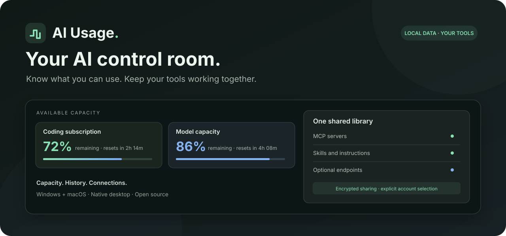

<div align="center">
  
  <br /><br />
  <a href="https://github.com/Clascheurduturfu/ai-usage/releases"></a>
  
  <a href="LICENSE"></a>
  
  <br /><br />
  <strong>Know what you can use. Keep your tools working together.</strong>
  <p>Quotas, usage, endpoints, MCP servers, skills and instructions in one desktop control room.</p>
  <a href="https://github.com/Clascheurduturfu/ai-usage/releases">Releases</a> ·
  <a href="#getting-started">Getting started</a> ·
  <a href="docs/architecture.md">Architecture</a> ·
  <a href="SECURITY.md">Security</a>
</div>

## A calmer view of your AI tools

AI Usage brings the information scattered across coding tools into one place: remaining capacity, reset times, activity and model costs. Its shared library keeps your MCP servers, skills and instructions consistent across clients and devices, while its endpoint manager lets you choose where requests go.

Built with **Tauri 2, React and a bundled Node runtime**, it stays available in the tray or menu bar after you close the dashboard. On macOS, closing the main window also hides the Dock icon. Quit stops the services the app owns.

### What you get

| Area | What it does |
| :--- | :--- |
| **Capacity at a glance** | Quota cards, remaining percentages and reset countdowns where providers expose them. |
| **Local usage history** | Tool, project, session and model views; cost estimates, charts and CSV export. |
| **One shared library** | MCP servers, skills with supporting files, and instructions synchronized into supported coding clients. |
| **Context budget** | Per-agent estimate of always-loaded tokens (tool schemas, skill index, rules), global enable switches, compact tool lists for huge MCPs, and per-tool call counts. |
| **Managed MCP sessions** | Pinned preparation, in-app OAuth, a native process supervisor, Stop/Resume, client isolation, bounded workers/queues and visible process ownership. |
| **Your choice of endpoint** | OpenAI Chat Completions, OpenAI Responses and Anthropic Messages, with 20 generic provider definitions. |
| **Local connections** | Loopback routes, aliases, client authentication, streaming and explicit Start / Stop / autostart controls. |
| **Encrypted sharing** | Publish your library and saved credentials through a folder synced by your existing cloud client. |
| **Updates and command palette** | Stable or Preview channel from GitHub Releases with verified downloads; Ctrl K to jump anywhere or toggle any MCP or skill. |
| **Google Workspace** | Official gws through the app adapter, with named accounts and explicit account selection on each request. |

The overview artwork is illustrative and contains invented data. Availability and quotas come from your own installed tools and accounts.

## Supported tools

Usage readers cover **Claude Code, Codex, Gemini CLI, OpenCode, ZCode, Antigravity, GitHub Copilot and Mistral Vibe**. Each reader uses the data that tool records; some provide tokens and costs, while others provide message or activity counts.

Shared-library adapters cover **Claude Code / Desktop, Codex, Gemini CLI, Antigravity, Cursor, Cline, OpenCode, ZCode and Copilot CLI**. Capabilities differ by client. Sync merges managed entries with unrelated settings and reports conflicts instead of silently overwriting newer edits.

The app's MCP preparation catalog recognizes Blender Lab, Playwright, Computer Use, REA, AWS MCP and the official gws adapter. Providers, desktop permissions, model servers and optional analysis backends may need their own setup. A connection check initializes a server and lists tools; it does not execute those tools.

## Getting started

1. Install the appropriate package from [Releases](https://github.com/Clascheurduturfu/ai-usage/releases): **Windows x64** or **macOS Apple Silicon**.
2. Open AI Usage and review **Connected tools**. Run a coding tool once if it has no local history yet, or select a custom data folder in Settings.
3. Add your MCP definitions and skills in **Shared library**, prepare local servers, review Sync and restart the coding clients after their configuration changes. Automatic sync is initially off; enable it when you are ready.
4. Add endpoints or profiles only when you need them. A fresh installation has 20 generic provider and local-server definitions and no saved profiles, accounts, MCP registrations, keys or ntfy channel.

Packages bundle Node and SQLite; end users do not need to install Node just to run AI Usage. Windows uses WebView2. Source-built macOS packages target macOS 12 or later. Version 1.0-beta-2 packages are unsigned on Windows and ad-hoc signed on macOS, without notarization. Settings → Updates checks GitHub Releases on a Stable or Preview channel, verifies the download's SHA-256 digest and installs only when you choose to.

**Moving from a private beta on macOS?** Publish a fresh encrypted library before replacing that installation. The public app uses a new app/Keychain identity, so its vault cannot directly unlock beta credentials. Enter your Sharing passphrase and Import to protect those credentials under the public identity. Keep the beta and its data until the import succeeds; provider sign-ins absent from the bundle need reconnecting. The public version series starts at 1.0.0-beta.3 independently of private beta numbering.

### Endpoints: configured does not mean running

Default endpoints receive catalog updates; custom entries and local edits are kept in `~/.agents/endpoints.custom.json`. Keys live in the encrypted device vault. An endpoint is a saved provider definition. It does not create a background process merely by appearing in the list. Choose **Add endpoint** to start from an optional **Ollama, LM Studio, OpenAI, Anthropic, Gemini, OpenRouter, Mistral, DeepSeek, Groq, Cerebras, NVIDIA, xAI, Together, Fireworks, Hugging Face, Inception, Ollama Cloud, DigitalOcean, Vercel or OpenCode** template, or enter another compatible API URL.

Local connections run as listeners inside AI Usage's broker. Start them explicitly, use a profile that needs one, or enable local autostart. Stop closes the listener; Quit stops all app-owned listeners. Ollama, LM Studio and other external servers have their own lifecycle. **Refresh models** reads metadata; **Try request** sends inference only when you click Send.

See the providers' [OpenAI API](https://developers.openai.com/api/reference/overview), [Anthropic API](https://platform.claude.com/docs/en/api/messages/create), [OpenRouter](https://openrouter.ai/docs/quickstart) and [LM Studio](https://lmstudio.ai/docs/developer/openai-compat) documentation for their authentication and compatibility requirements.

### Share a library between devices

Select a folder already synchronized by your cloud client, enter a strong passphrase, then **Publish**. On the destination, select that folder and use **Import** with the same passphrase. Prepare its missing local MCP servers separately.

The encrypted bundle includes custom endpoint definitions **and saved API keys**, profiles, routes, MCP definitions, skills/assets, instructions, Google Workspace accounts and the "connect through AI Usage" setting of each remote MCP. Imported credentials are protected by the destination's own vault. Remote MCP OAuth sign-ins (for example Cloudflare) are never published or imported: providers rotate their refresh tokens, so a copied sign-in breaks whichever device refreshes second. Sign in once per device; Import never replaces or removes a local sign-in. Newly imported listeners remain stopped; existing devices retain their local listener preferences.

Usage databases, backups, transient processes and local installation payloads stay on the device. A localhost endpoint still needs its model server on the destination. Provider-revoked or device-bound authentication may require reconnecting. Read [Security](SECURITY.md) before sharing a credential-bearing bundle.

### Google Workspace

Choose **Add Google Workspace** in Shared library → MCP and prepare the adapter, then use your own Google Cloud Desktop OAuth client in its Workspace card, then add an account with a name such as `personal` or `work`. The adapter exposes `workspace_accounts`, `workspace_schema` and `workspace_call`. Agents must choose a configured account explicitly on every action. No account or OAuth project is shipped in the application.

### Android companion

The optional [Android companion source](android/) provides snapshot views and home-screen widgets through ntfy. Topic and token are empty by default. Configure your own private authenticated channel; this snapshot transport is separate from encrypted library Sharing. An Android package is not part of the desktop beta release.

## Build from source

Use **Node.js 24.14 or later**, **Rust stable**, and the [Tauri native prerequisites](https://v2.tauri.app/start/prerequisites/). Windows builds need MSVC build tools; macOS builds need Xcode command-line tools.

```sh
git clone https://github.com/Clascheurduturfu/ai-usage.git
cd ai-usage
npm ci
npm run dev
```

Build a Windows installer:

```sh
npm run dist
```

Build the macOS app and DMG on a Mac:

```sh
sh scripts/build-mac.sh
```

Builds are ad-hoc signed by default. Set `AIU_MAC_SIGN_IDENTITY` (SHA-1 or name of a code-signing identity; a self-signed certificate works) and, if it lives outside your default keychains, `AIU_MAC_SIGN_KEYCHAIN` to sign every build with the same identity. A stable identity keeps the designated requirement constant, which privacy permissions rely on. It does not stop the one Keychain prompt per update: without an Apple Team ID, macOS ties "Always Allow" to each build's code hash. Gatekeeper still treats downloaded copies as unnotarized.

For a UI-only preview with fictional data:

```sh
npm run preview:ui
```

Generated installers live under `src-tauri/target/release/bundle/` and are ignored by Git. The build workflow packages Windows and Apple Silicon macOS artifacts; it does not automatically publish releases. See [Contributing](CONTRIBUTING.md) for available validation commands.

## Project layout

```text
src/main/           Scanners, quotas, SQLite and the shared-library manager
src/renderer/       React desktop interface
src/shared/         Types, protocols and optional endpoint templates
proxies/            Endpoint adapters, protocol conversion and listeners
src-tauri/          Native shell, vault protection, tray and packaging
android/            Optional snapshot/widget companion
tests/              Synthetic fixtures and existing contract tests
resources/          Authored icons and third-party license notices
docs/               Architecture and release documentation
```

Model costs are estimates, not invoices. Subscription quotas and credentials remain subject to each provider's rules. Usage scanning is local; quota reads, configured endpoints, OAuth and optional sharing may contact their respective services.

## License

[MIT](LICENSE). Third-party components retain their own licenses and notices in `resources/licenses/` and `src/main/manager/vendor/`. Optional installed MCP servers retain their upstream licenses, including Blender Lab's GPL license.
