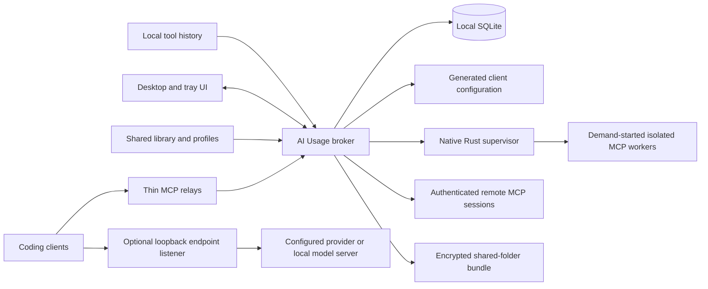

# Architecture

AI Usage uses a native Tauri shell, a React interface and a bundled Node broker. The broker owns scanning, SQLite, quotas, library synchronization, endpoint listeners and MCP sessions. Closing the dashboard releases its WebView; the tray/menu-bar manager remains until Quit.

## Endpoint lifecycle

Saving an endpoint stores its URL, protocol, model cache and protected key reference. It creates no process or listener. Refresh models makes a metadata request; Try request performs inference only after the user sends it.

A local connection is an HTTP listener inside the existing broker, not a separate daemon per endpoint. It starts on Start, when applying/launching a profile that needs it, or at app startup when its local autostart preference is enabled. It remains idle between requests. Stop closes its connections; Quit stops all app-owned listeners and MCP transports. Existing external services such as Ollama or LM Studio manage their own lifecycle.

## Sharing

Publish creates an AES-256-GCM bundle with a scrypt-derived passphrase key, random salt and nonce, and authenticated revision metadata. It contains endpoint definitions and keys, profiles, connection routes/keys, MCP definitions or pinned preparation recipes, skills/assets, instructions, Google Workspace accounts and per-MCP "connect through AI Usage" settings. Remote MCP OAuth grants are device-bound and never leave the device.

Import backs up current data and re-encrypts credentials through the destination's native vault. Matching existing listener ports and autostart choices stay local; newly imported listeners do not autostart. Executable payloads are installed separately with Prepare. Localhost endpoint URLs refer to the destination device, so its local model server must exist there.

Usage databases, transient processes and local installation receipts are not published. Import keeps every local MCP sign-in and its setting, including servers the publishing device never configured; grants found in older bundles are ignored. Failed OAuth recovery stages replacement credentials until a token grant succeeds. Revoked or device-bound grants can still require consent.

The optional Android companion consumes ntfy usage snapshots. That channel is separate from encrypted library Sharing and has no configured topic or token in a fresh install.

## MCP runtime bounds

Clients use a native relay with no persistent Node process per MCP. The supervisor admits eight resident workers globally, at most six isolated/stateful workers, and two execution workers per MCP. The two reserved slots allow discovery and stateless commands even while stateful sessions are idle. Saturation returns an explicit error rather than waiting indefinitely.

Remote MCP relays keep the client connection open when the upstream fails. Initialization and sign-in errors are returned as JSON-RPC errors with the actual reason. An expired (HTTP 404) or dropped upstream session is reopened once per request. A token-service outage (HTTP 5xx or network) keeps the saved sign-in and is reported as temporary. Public servers advertising only tools, prompts and completions share one upstream session; others get one per client.

On Windows, a launch from inside another app's MSIX package (for example a relay started by a packaged coding client) relaunches through Explorer, so AppData writes are never redirected into that package. A copy installed inside a package's LocalCache shows a reinstall warning. Preparation executes pinned entry points with their package/virtual-environment paths.

Initialize and tools/list use bounded temporary discovery and metadata caching; a virtual client can stay connected without a worker. Each real worker gets a full initialize/initialized handshake. Stateful browser, Blender, desktop and custom sessions stay isolated until Stop or disconnect. Official gws commands exit after each call; public tools-only Cloudflare Docs connections can be shared, expire after ten idle minutes and negotiate again on next use. Tool results are never cached.

Control traffic bypasses tool queues. Pending execution is bounded to 16 requests per client, 64 globally and 16 MiB of queued JSON. Stop/Resume is device-local and preserves definitions and credentials. Windows workers enter strict kill-on-close Job Objects before running. macOS workers have process groups and inherited UUIDs; a native lifeline also cleans marked same-user descendants after supervisor death. This tracks owned descendants, not a security sandbox against programs intentionally stripping the marker. External browsers should be connected by their CDP endpoint; Blender should be connected through its addon.

Native Responses traffic preserves SSE bytes, including event/id/retry fields. Stateless/conversion routes reject previous_response_id, conversation, stored responses, background mode and hosted tools with a 400 error.

## Context controls

Sync omits MCP servers and skills listed as globally disabled from every client. For a server marked compact, sync gives eager clients the relay name `<server>@compact`; Claude Code and Antigravity, which defer tool schemas themselves, keep the plain relay. The broker answers a compact session's `tools/list` with a search tool and a call tool built from the full list, answers searches itself, and rewrites the call tool into the real `tools/call`. Every relayed `tools/list` is measured (tool count, schema bytes) and every `tools/call` is counted per tool, with failures, in `mcp-metrics.json` in the app data folder. Arguments and results are never stored.

Globally disabled skills are moved from `~/.agents/skills` to `~/.agents/skills-disabled` when sync applies, so clients that scan the shared folder stop loading them; profile-level exclusions still rely on each client's own per-skill setting. Sharing publishes both folders and moves parked skills back before an import. Claude Code reads only `~/.claude/skills`, so sync copies enabled shared skills there, tracked by the same ledger as Antigravity's copy.

## Updates

`src/main/updater.ts` reads the 30 most recent GitHub Releases of the public repository without credentials. Stable accepts published releases that are not prereleases and have a final semantic version; Preview accepts published prereleases with a prerelease version, plus newer Stable releases. A release whose flag and version disagree is ignored. The newest candidate must carry exactly one package for the platform (`AI Usage_<version>_x64-setup.exe`, `AI Usage_<version>_aarch64.dmg`) with a `sha256:` asset digest, or the update is refused with a pointer to the Releases page. Downloads follow redirects only to GitHub asset hosts over HTTPS, stream into a private per-attempt folder under the app data folder with a size limit, and are hashed before they can be installed. Install re-reads the release, refuses while a shared-library change is queued, and on Windows starts the NSIS installer with `/P /R` through WMI, because the broker runs inside the shell's kill-on-close job object and a child process would be terminated when the installer closes the app. On macOS the verified disk image is opened for a manual replacement. Preferences (channel, daily launch check, last check time) live in the usage database's key-value table. `.github/workflows/release.yml` publishes in this shape.

The usage database uses Node's built-in `node:sqlite` (Node 24 or later); its experimental-feature notice is filtered at load.
